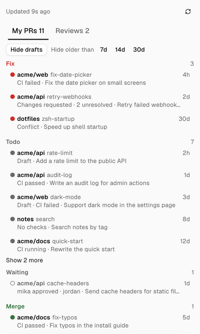
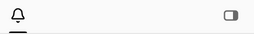
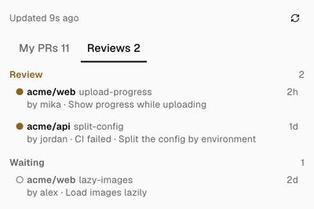
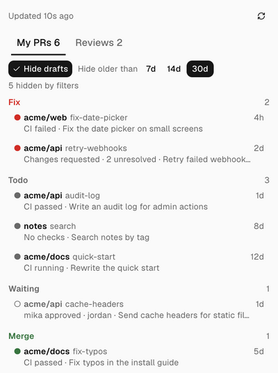
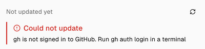

# PRs for Orca

[English](README.md)

GitHub の自分の PR と自分に来ているレビュー依頼を、次にやることで分けて並べる [Orca](https://github.com/stablyai/orca) のプラグインです。



*画像のデータはすべて架空のものです。*

## できること

- 開いている自分の PR をすべてのリポジトリから集めて、`Fix`、`Todo`、`Waiting`、`Merge` に分けます。
- 自分に来ているレビュー依頼と、自分がレビューして作者の対応を待っている PR を、もう 1 つのタブに並べます。
- 修正依頼、CI の失敗、コンフリクト、誰を待っているかなど、その状態になった理由を出します。
- 行を押すと、その PR をブラウザーで開きます。
- GitHub からは読み取るだけです。PR を変更することはありません。

## 必要なもの

| | |
| --- | --- |
| Orca | 1.4.259 以上（1.4.271 で確認） |
| OS | macOS で確認しています。Linux は未確認で、Windows にはまだ対応していません |
| [GitHub CLI](https://cli.github.com/) | github.com にログインした `gh` |

GitHub Enterprise Server では確認していません。

## インストール

### 1. GitHub CLI にログインする

`gh` がなければインストールします。macOS の Homebrew なら次のとおりです。

```sh
brew install gh
```

ログインして、結果を確認します。

```sh
gh auth login
gh auth status
```

### 2. プラグインを追加する

Orca の画面から追加する場合は、次の順に操作します。

1. 「設定」→「プラグイン」を開きます。プラグインがオフになっていれば、先にオンにします。
2. 「プラグインを追加」→「Git URL から…」を選びます。
3. `https://github.com/shakechi/orca-prs` を貼り付けて続行します。
4. プラグインが求めるアクセスを確認し、「インストールして有効化」を押します。アクセスの内容は[アクセスとプライバシー](#アクセスとプライバシー)で説明しています。

ターミナルから追加する場合は、次のコマンドを実行します。

```sh
orca plugin install shakechi/orca-prs
```

1 回目の実行では何もインストールされません。プラグインが求めるアクセスと、末尾に `--approve` とフィンガープリントの付いたコマンドが表示されます。そのコマンドを実行すると、インストールされます。

### 3. パネルを開く

右サイドバーの上にあるベルのアイコンを押します。



最初の表示には数秒かかります。

## パネルの使い方

### My PRs

自分が作った PR です。次の表の条件を上から順に確かめ、最初に当てはまった状態に分けます。

| 状態 | 条件 | 誰の番か |
| --- | --- | --- |
| `Fix` | 修正依頼が残っている、CI が失敗している、コンフリクトしている、のどれか | 自分 |
| `Merge` | 必要な Approve がそろっている | 自分 |
| `Waiting` | レビューを依頼している、またはコメントだけのレビューが付いた | 相手 |
| `Todo` | それ以外（レビューをまだ依頼していない、など） | 自分 |

- Draft は、CI が失敗していてもコンフリクトしていても `Todo` に置きます。修正依頼が残っているときだけ `Fix` に移ります。
- 修正を依頼した人にもう一度レビューを依頼すると、`Waiting` に移ります。
- 必須ではないチェックの失敗も CI の失敗として扱います。
- レビューなしでマージするリポジトリの PR は `Todo` に残ります。

### Reviews

ほかの人が作った PR です。自分が Approve したものは出ません。



| 状態 | 条件 | 誰の番か |
| --- | --- | --- |
| `Review` | 自分か自分のチームにレビューの依頼が来ている | 自分 |
| `Waiting` | 自分が修正を依頼したかコメントして、再依頼がまだ来ていない | 相手 |

### 行の見方

```
● acme/api  retry-webhooks                                2d
  Changes requested · 2 unresolved · Retry failed webhooks…
```

- 1 行目はリポジトリ、ブランチ、最後の更新からの時間です。自分のリポジトリでは所有者の名前を省きます。`mika/fix-login` のように、ブランチが作者の名前で始まるときは、その部分を省きます。
- 2 行目は理由とタイトルです。
- 塗りつぶした点（●）は自分の番、白抜きの点（○）は相手を待っていることを表します。

タブの数字は自分の番になっている PR の数です。

| 理由 | 意味 |
| --- | --- |
| `Changes requested` | レビュアーから修正を依頼された |
| `2 unresolved` | 解決していないレビューのスレッドの数 |
| `CI failed` / `CI running` / `CI passed` | 最後のコミットのチェックの結果 |
| `No checks` | 最後のコミットにチェックがない |
| `Conflict` | ベースブランチとコンフリクトしている |
| `Draft` | Draft の PR |
| `jordan` | jordan のレビューを待っている。3 人以上なら `3 reviewers` |
| `mika approved · jordan` | mika は Approve 済みで、jordan のレビューを待っている |
| `mika commented` | mika がコメントだけを付けた |
| `More reviews needed` | Approve はあるが、リポジトリが必要とする人数に足りない |
| `by mika` | mika が作った PR（Reviews タブ） |
| `Not fully read` | 一部のデータを読めなかった。`Merge` には置かない |

### 絞り込み



- `Hide drafts` は Draft を隠します。
- `Hide older than` の `7d`、`14d`、`30d` は、その日数以上更新されていない PR を隠します。選択中の日数をもう一度押すと、隠した PR がまた表示されます。

絞り込みは `My PRs` のすべての状態に適用され、次に開いたときも残ります。`Reviews` には適用されません。どの状態も最初は 5 件まで表示し、残りは `Show n more` を押すと表示されます。

### 更新

パネルが見えている間は、データが 5 分より古くなると取り直します。右上のボタンを押すと、すぐに取り直せます。

1 つの検索につき、更新が新しいものから 200 件まで読みます。それより多いときは、読まなかった件数を表示します。

## 設定

「設定」→「プラグイン」→「PRs」を開きます。

| 項目 | 内容 |
| --- | --- |
| Repositories to show | 一覧に出す所有者やリポジトリ（例: `acme`、`acme/api`）。空白、カンマ、改行で区切ります。空ならすべて出します。存在しない名前を書くと、何も一致しません |
| Path to the gh command | `gh` のフルパス（例: `/opt/homebrew/bin/gh`）。空なら PATH から探します |

## アクセスとプライバシー

- このプラグインはワーカーを動かすため、Orca が承認を求めます。ワーカーはあなたのユーザー権限でこのマシンにアクセスできる Node.js のプロセスです。配布元を信頼できる場合だけインストールしてください。
- ワーカーは読み取り専用の問い合わせで `gh api graphql` を実行します。ログイン情報は `gh` が持ち、プラグインはトークンを受け取らず、保存もしません。
- プラグインは GitHub 以外にデータを送りません。
- Orca に求める権限はプラグイン自身の設定の読み書きだけです。

## 困ったとき



| 表示 | 対処 |
| --- | --- |
| `gh is not signed in to GitHub` | ターミナルで `gh auth login` を実行してから、更新ボタンを押します |
| `The gh command (gh) was not found` | GitHub CLI をインストールします。インストール済みなら、`Path to the gh command` に `which gh` の出力を設定します |
| `GitHub: Bad credentials` | `gh auth login` をやり直します |
| `GitHub did not answer in time` | 接続を確認して、更新ボタンを押します |
| `Could not read the targets setting` | `Repositories to show` を直します。`owner` か `owner/repo` の形で書きます |
| `Ignored targets` | 読めなかった項目です。ほかの項目は使われます |
| `1 pull request could not be read` | GitHub が一部のデータを返しませんでした。GitHub から理由が届いたときは、後ろに表示されます |
| 出るはずの PR が出ない | `Repositories to show`、絞り込み、`gh auth status` に出るアカウントを確認します |

ワーカーの記録は `orca plugin logs shakechi.prs` で確認できます。

## 更新とアンインストール

```sh
orca plugin update shakechi.prs
orca plugin uninstall shakechi.prs
```

どちらの操作も「設定」→「プラグイン」の画面からもできます。

## 開発

ビルドは不要です。Orca が `src/` のファイルを読み込むときに変換します。

```sh
git clone https://github.com/shakechi/orca-prs
cd orca-prs
npm install
orca plugin dev load .     # このフォルダーを Orca に読み込む（承認を求められます）
npm run check              # 型、書式、マニフェスト、テスト、パネルの検査
```

| ファイル | 役割 |
| --- | --- |
| `src/panel.tsx` | パネルを描く。並べ方と絞り込みはここで決める |
| `src/worker.ts` | いつ取得するかを決め、結果を保持する |
| `src/collect.ts` | 3 つの検索を実行して、行にする |
| `src/github.ts` | 検索の文と、応答の読み取り |
| `src/classify.ts` | 状態と理由を決める。例は `src/classify.test.ts` にある |
| `src/gh.ts` | `gh` を実行する |
| `fixtures/` | テストと検査で使う偽物の `gh`。GitHub には問い合わせない |

パネルの文は英語、コードのコメントは日本語です。
