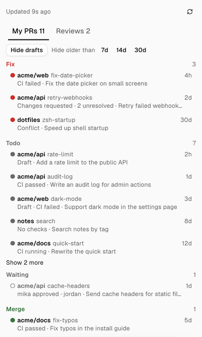
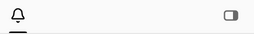
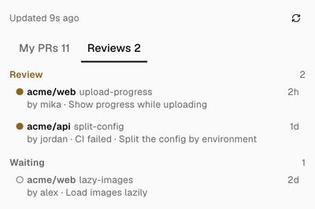
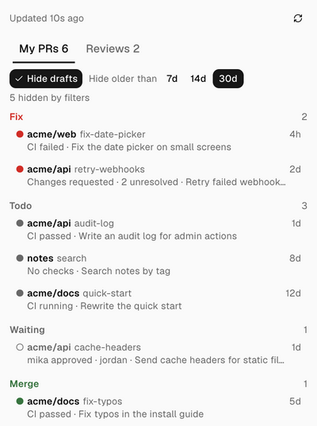
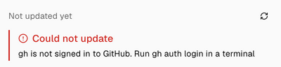

# PRs for Orca

[日本語](README.ja.md)

A plugin for [Orca](https://github.com/stablyai/orca) that lists your GitHub pull requests, and the reviews requested from you, by what to do next.



*All screenshots show fictional data.*

## What it does

- Groups your open pull requests from every repository into **Fix**, **Todo**, **Waiting** and **Merge**.
- Lists the reviews requested from you, and the reviews you are waiting on the author for, in a second tab.
- Shows the reason for each state: changes requested, failed CI, a conflict, or who you are waiting for.
- Opens the pull request in your browser when you press a row.
- Reads GitHub only. It never changes a pull request.

## Requirements

| | |
| --- | --- |
| Orca | 1.4.259 or later (checked on 1.4.271) |
| OS | Checked on macOS. Linux has not been tested. Windows is not supported yet |
| [GitHub CLI](https://cli.github.com/) | `gh`, signed in to github.com |

GitHub Enterprise Server has not been tested.

## Install

### 1. Sign in to GitHub CLI

Install `gh` if you do not have it. On macOS with Homebrew:

```sh
brew install gh
```

Then sign in and check the result:

```sh
gh auth login
gh auth status
```

### 2. Add the plugin

In Orca:

1. Open **Settings → Plugins**. If plugins are off, turn them on first.
2. Choose **Add plugin → From a Git URL…**.
3. Paste `https://github.com/shakechi/orca-prs` and continue.
4. Read the access it asks for (see [Access and privacy](#access-and-privacy)), then press **Install & enable**.

Or in a terminal:

```sh
orca plugin install shakechi/orca-prs
```

This first run installs nothing. It prints the access the plugin asks for and a command that ends with `--approve` and a fingerprint. Run that command to install.

### 3. Open the panel

Press the bell icon at the top of the right sidebar.



The first load takes a few seconds.

## Using the panel

### My PRs

Pull requests you opened. The first rule that matches, from top to bottom, decides the state.

| State | When | Whose turn |
| --- | --- | --- |
| **Fix** | Changes are requested, CI failed, or there is a conflict | Yours |
| **Merge** | It has the approvals it needs | Yours |
| **Waiting** | You requested a review, or someone left a review with comments only | Theirs |
| **Todo** | Anything else, such as a review you have not requested yet | Yours |

- A draft stays in **Todo** even with failed CI or a conflict. It moves to **Fix** only when changes are requested.
- When you request a review again from the person who asked for changes, the pull request moves to **Waiting**.
- A failed check counts as failed CI even if the check is not required.
- In a repository where you merge without reviews, a pull request stays in **Todo**.

### Reviews

Pull requests other people opened. Those you approved are not listed.



| State | When | Whose turn |
| --- | --- | --- |
| **Review** | A review is requested from you or your team | Yours |
| **Waiting** | You requested changes or commented, and have not been asked to review again | Theirs |

### Reading a row

```
● acme/api  retry-webhooks                                2d
  Changes requested · 2 unresolved · Retry failed webhooks…
```

- First line: repository, branch, and time since the last update. The owner is left out for your own repositories. If the branch starts with the author's name, as in `mika/fix-login`, that part is left out.
- Second line: the reason, then the title.
- A filled dot (●) means it is your turn. A hollow dot (○) means you are waiting for someone.

The number on each tab counts the pull requests where it is your turn.

| Reason | Meaning |
| --- | --- |
| `Changes requested` | A reviewer asked for changes |
| `2 unresolved` | Review threads that are not resolved |
| `CI failed` / `CI running` / `CI passed` | Result of the checks on the last commit |
| `No checks` | The last commit has no checks |
| `Conflict` | It conflicts with the base branch |
| `Draft` | It is a draft |
| `jordan` | Waiting for a review from jordan. Three or more become `3 reviewers` |
| `mika approved · jordan` | mika approved, and jordan's review is still pending |
| `mika commented` | mika left comments only |
| `More reviews needed` | Approved, but not by as many people as the repository requires |
| `by mika` | Opened by mika (Reviews tab) |
| `Not fully read` | Some of its data could not be read. It is never shown as **Merge** |

### Filters



- **Hide drafts** hides drafts.
- **Hide older than 7d / 14d / 30d** hides pull requests not updated for that many days. Press the selected one again to show them.

Filters apply to every state in **My PRs** and are remembered. They do not apply to **Reviews**. Each state shows five rows at first; press **Show n more** for the rest.

### Updates

While the panel is visible, it fetches again when the data is more than five minutes old. Press the button at the top right to fetch now. It reads up to the 200 most recently updated pull requests per search and tells you how many it left out.

## Settings

Open **Settings → Plugins → PRs**.

| Setting | What it does |
| --- | --- |
| Repositories to show | Limits the list to these owners or repositories, for example `acme` or `acme/api`. Separate them with spaces, commas or new lines. Empty shows all. A name that does not exist matches nothing |
| Path to the gh command | Full path to `gh`, for example `/opt/homebrew/bin/gh`. Empty finds it on PATH |

## Access and privacy

- The plugin runs a worker, so Orca asks you to approve it. The worker is a Node.js process with your user account's access to the machine. Install it only if you trust the source.
- The worker runs `gh api graphql` with read-only queries. The sign-in stays in `gh`; the plugin does not receive or store a token.
- It does not send your data anywhere except GitHub.
- The only Orca permission it asks for is to read and change its own settings.

## Troubleshooting



| Message | What to do |
| --- | --- |
| `gh is not signed in to GitHub` | Run `gh auth login` in a terminal, then press the refresh button |
| `The gh command (gh) was not found` | Install GitHub CLI. If it is installed, set **Path to the gh command** to the output of `which gh` |
| `GitHub: Bad credentials` | Run `gh auth login` again |
| `GitHub did not answer in time` | Check your connection and press the refresh button |
| `Could not read the targets setting` | Fix **Repositories to show**. Use `owner` or `owner/repo` |
| `Ignored targets` | Those entries could not be read. The rest are used |
| `1 pull request could not be read` | GitHub did not return some of the data. A reason from GitHub, if any, follows the message |
| A pull request is missing | Check **Repositories to show**, the filters, and whether `gh auth status` shows the right account |

`orca plugin logs shakechi.prs` shows what the worker recorded.

## Update and uninstall

```sh
orca plugin update shakechi.prs
orca plugin uninstall shakechi.prs
```

You can do both in **Settings → Plugins** too.

## Development

There is no build step. Orca transpiles the files in `src/` when it loads them.

```sh
git clone https://github.com/shakechi/orca-prs
cd orca-prs
npm install
orca plugin dev load .     # load this folder into Orca (asks for approval)
npm run check              # types, lint, manifest, tests and panel checks
```

| File | Role |
| --- | --- |
| `src/panel.tsx` | Draws the panel. Order and filters live here |
| `src/worker.ts` | Decides when to fetch and keeps the result |
| `src/collect.ts` | Runs the three searches and turns them into rows |
| `src/github.ts` | Search queries and reading the answers |
| `src/classify.ts` | Decides the state and the reason. Examples are in `src/classify.test.ts` |
| `src/gh.ts` | Runs `gh` |
| `fixtures/` | Stand-ins for `gh` used by tests and checks. They do not contact GitHub |

Text in the panel is English. Comments in the code are Japanese.
